<!-- ==============================================================================
     HERO TERMINAL: Monochrome ASCII Portrait + 3D Extruded ASCII Wordmark
     Widths 370 / 490 ensure identical ~385px visual height across browsers.
     ============================================================================== -->

<h3><code>Venky9959-code@github ~ $ whoami</code></h3>

<table>
<tr>
<td valign="top" align="center"></td>
<td valign="top" align="center"></td>
</tr>
</table>

 

  <b>Computer Science Engineering Student · Aspiring Full-Stack Developer · AI Enthusiast</b> 
  <i>"Don't just learn technology. Use technology to create something meaningful."</i>

<!-- ==============================================================================
     QUICK NAVIGATION BADGES
     ============================================================================== -->

 
 

<!-- ==============================================================================
     LIVE ANIMATED CONTRIBUTION HEATMAP
     Auto-refreshed daily via .github/workflows/update-profile-art.yml
     ============================================================================== -->

<h3><code>Venky9959-code@github ~ $ ./contributions.sh</code></h3>

 
 

<!-- ==============================================================================
     GITHUB ANALYTICS & STREAKS
     ============================================================================== -->

<h3><code>Venky9959-code@github ~ $ ./stats.sh --all</code></h3>

  
  &nbsp;&nbsp;
  
  &nbsp;&nbsp;
  

 

---

### <code>$ cat about-me.txt</code>

I am **Banavathu Venkateswararao (Venky)**, a passionate Computer Science and Engineering student at **Velagapudi Ramakrishna Siddhartha Engineering College (VRSEC)**, Vijayawada. I specialize in full-stack web development, backend engineering, and artificial intelligence solutions.

- 🎓 **Undergraduate:** B.Tech in Computer Science and Engineering (2023 – 2027) | **CGPA: 8.06**
- 🏫 **Schooling:** AP Model School & Junior College Maddulaparva (XII: 87.7% · X: 92.6%)
- 💡 **Core Mission:** Transforming innovative concepts into accessible, scalable, and user-centric real-world software.
- 🔭 **Current Focus:** Architecting robust RESTful APIs, progressive web applications (PWA), and machine learning predictive pipelines.
- 🤝 **Leadership & Teamwork:** Project Team Lead, freelance developer with Peakoo Agency, and active member of Team Visionaries & Achievers Club.

 

---

### <code>$ ls -la ./technical-arsenal/</code>

<table>
  <tr>
    <td width="20%" valign="top"><b>Programming Languages</b></td>
    <td>
      
      
      
      
      
    </td>
  </tr>
  <tr>
    <td valign="top"><b>Frontend Engineering</b></td>
    <td>
      
      
      
      
      
      
      
    </td>
  </tr>
  <tr>
    <td valign="top"><b>Backend Engineering</b></td>
    <td>
      
      
      
      
      
      
    </td>
  </tr>
  <tr>
    <td valign="top"><b>Databases & Storage</b></td>
    <td>
      
      
      
    </td>
  </tr>
  <tr>
    <td valign="top"><b>AI & Machine Learning</b></td>
    <td>
      
      
      
      
      
      
    </td>
  </tr>
  <tr>
    <td valign="top"><b>Development Tools</b></td>
    <td>
      
      
      
      
      
      
    </td>
  </tr>
</table>

 

---

### <code>$ ./featured-projects.sh</code>

#### 1. 🏥 Epidemiological Analysis & Forecasting of Climate-Sensitive Diseases
> *Area-Specific Health Web Application & Early Warning System*
- **Overview:** Engineered a predictive healthcare intelligence web application that correlates historical morbidity records with local meteorological datasets (temperature, precipitation, humidity).
- **Core Capabilities:**
  - Disease-risk forecasting utilizing **Facebook Prophet** time-series modeling.
  - Interactive geographical heatmaps and localized outbreak vulnerability metrics.
  - Multi-tier role-based access for the public, ASHA community healthcare workers, and department officials.
  - Offline-ready **Progressive Web App (PWA)** architecture for deployment in remote zones.
- **Technologies:** `React.js` · `Python` · `Facebook Prophet` · `Machine Learning` · `MySQL` · `Node.js` · `Express.js` · `PWA`

---

#### 2. ♻️ Smart Waste Segregation Using Convolutional Neural Networks
> *Automated Deep Learning & Computer Vision Waste Classifier*
- **Overview:** Developed an automated computer vision system utilizing deep learning to classify discarded materials into recyclable and non-recyclable streams, accelerating municipal and institutional recycling pipelines.
- **Core Capabilities:**
  - Automated image-based recognition trained on heterogeneous waste datasets.
  - High-precision multi-class sorting using customized **Convolutional Neural Networks (CNN)**.
  - Ready for integration with IoT smart bins and robotic sorting mechanisms.
- **Technologies:** `Python` · `Convolutional Neural Networks (CNN)` · `Deep Learning` · `OpenCV` · `TensorFlow/Keras`

---

#### 3. 🎓 SkillsBoostHub – Student Skill Development Platform
> *Centralized Career Preparation & Interactive Learning Hub*
- **Overview:** Architected a comprehensive full-stack digital learning ecosystem enabling students to acquire high-demand engineering skills, practice coding assessments, and track career readiness.
- **Core Capabilities:**
  - Secure student authentication with **Nodemailer OTP verification** and role authorization.
  - Live lecture scheduling, recorded lecture repository, and curated PDF material delivery.
  - Interactive skill assessment engine with instant score diagnostics and progress dashboards.
  - Integrated digital course checkout powered by **Razorpay API**.
- **Technologies:** `React.js` · `JavaScript` · `Node.js` · `Express.js` · `MySQL` · `Razorpay Integration` · `Nodemailer` · `CSS3`

---

#### 4. 🍽️ Restaurant Order & Lifecycle Management System
> *Full-Stack Python/Django Workflow Automation Portal*
- **Overview:** Built an end-to-end order processing application with strict database validation, status lifecycle state machines, and real-time order tracking.
- **Core Capabilities:**
  - Full lifecycle state tracking (`Placed` → `Cooking` → `Prepared` → `Delivered`) with automated frontend reactivity.
  - Role-based permissions for kitchen staff, administrators, and clientele.
- **Technologies:** `Python` · `Django` · `REST API` · `SQLite/MySQL` · `Bootstrap/Tailwind`

 

---

### <code>$ ./leadership-and-experience.sh</code>

- 👥 **Team Lead – Epidemiological Analysis Project (2025):** Spearheaded architecture planning, dataset ingestion, team milestone tracking, ASHA workflow coordination, and executive presentations.
- 💼 **Freelance Web Developer & Digital Strategist – Peakoo Agency:** Built and deployed responsive production web solutions for commercial clients, including *Dial A Septic Tank Cleaners*, managing full development and delivery lifecycles.
- 🚀 **Team Visionaries & Achievers Club:** Active engagement in entrepreneurial initiatives, LinkedIn technical networking, community communication, and collaborative team development.

 

---

<h3><code>Venky9959-code@github ~ $ ./contact.sh</code></h3>

I am actively exploring software engineering internships, full-stack development roles, and collaborative open-source projects.

&nbsp;

&nbsp;

  

<code>Venky9959-code@github ~ $ exit 0</code>

 
Designed with clean terminal aesthetics for Banavathu Venkateswararao (Venky) • © 2026

